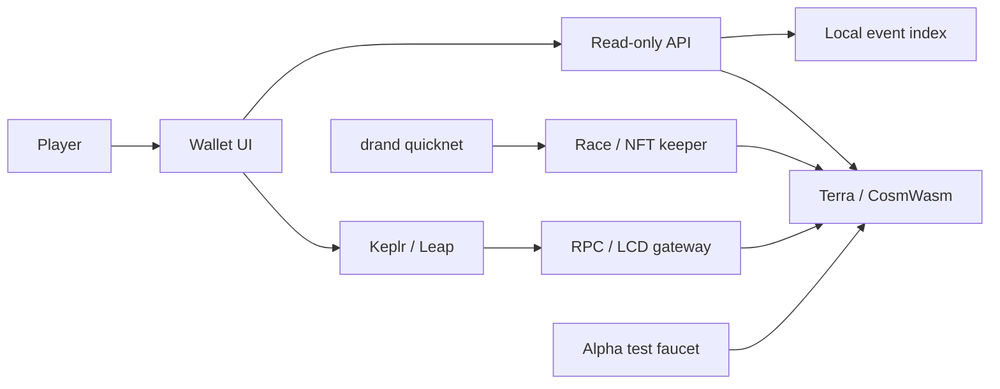

# Architecture

## Contracts

- **Fleet** owns permanent levels, purchase invoices, referral registration and
  the presale clock. Purchased changes are queued for a race boundary.
- **Race** snapshots eligible fleets/equipment, processes bounded movement and
  combat, validates randomness, chooses winners and drives cycle settlement.
- **Randomness / beacon verifier** commit future drand rounds and validate
  quicknet BLS proofs. Display projections do not choose winners.
- **Rewards / reinvestment** separate reserve accrual, available pools, claim
  liabilities and optional reward-to-level progress.
- **Collection / equipment / recruitment / skins** manage NFTs, custody,
  commanders, fusion and milestone draws.
- **Clans / marketplace / payments / treasury / pause** provide membership,
  trades, conversion routes, capital operations and coordinated pause checks.

Protocol details are in the Markdown references under `contracts/`.

## Read model and interface

`src/onchain` pins reads to committed chain state, indexes successful public
events into SQLite, and exposes history, balances, leaderboards and projections.
Fork handling rewinds indexed state. Projected distance is display-only.

`front/onchain` is bundled with esbuild. It constructs transactions and delegates
signatures to Keplr/Leap. The hangar compares owned base stats with target-level
stats; tank repair examples use the deployed repair formula. Damaged race state
is distinct from next-race upgraded state.

## Alpha boundary

The alpha is a separate test chain. Its faucet mints test assets and transfers
native test LUNC using isolated Docker fixture keys. First wallet connection
requests one durable starter grant; reconnecting does not duplicate the grant.

The standalone alpha gateway restricts exposed RPC methods and transaction
types. It **does not implement the hosted Colapsar login/authorization layer**.
Private hosting must add its own signed-wallet access control in front of it.
See [alpha hosting](ALPHA.md).

## Credentials and state

Player keys stay in the wallet. Generated operator/keeper/faucet keys stay in
the test chain's Docker volume. Runtime manifests contain deployment metadata,
not secrets, but are generated per environment and are not versioned. SQLite
indexes and faucet grant records are runtime files, also excluded from Git.
